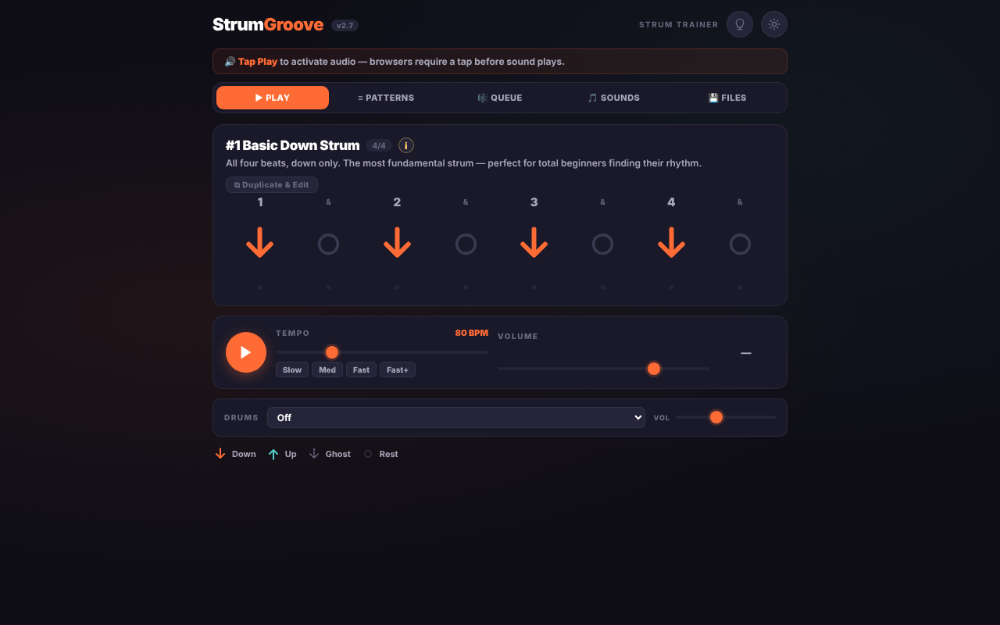
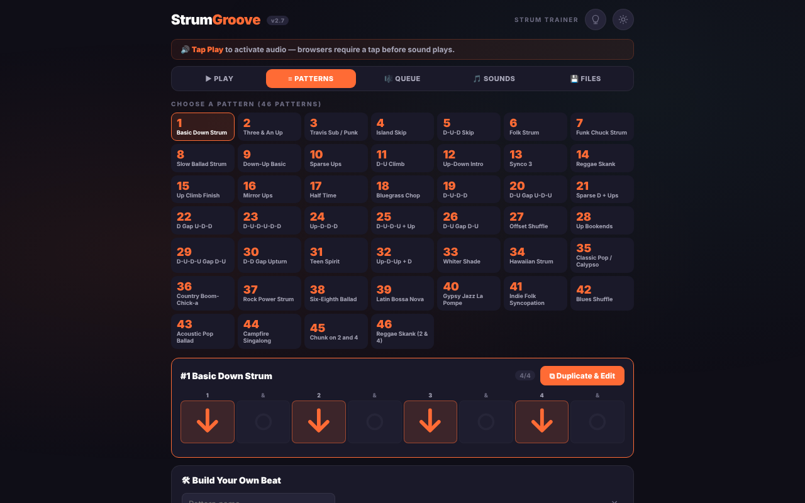
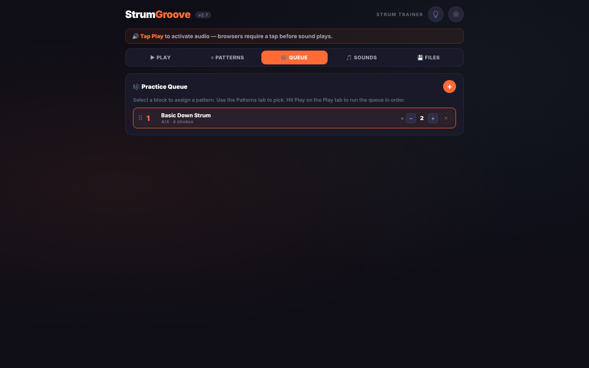

# StrumGroove User Manual v2.7

## Table of Contents
1. [Getting Started](#getting-started)
2. [The Interface](#the-interface)
3. [Play Tab](#play-tab)
4. [Patterns Tab](#patterns-tab)
5. [Queue Tab](#queue-tab)
6. [Sounds Tab](#sounds-tab)
7. [Files Tab](#files-tab)
8. [Tips & Tricks](#tips--tricks)
9. [Troubleshooting](#troubleshooting)

---

## Getting Started

### Installation
StrumGroove requires **no installation**. Simply:
1. Download `strumgroove.html` from GitHub
2. Open the file in any modern web browser
3. Start practicing!

The entire app runs in your browser — no server connection, no account, no signup needed.

### First Launch
When you first open StrumGroove, you'll see the **Play** tab with:
- A pattern display showing downstrokes (↓) and upstrokes (↑) with beat numbers
- Volume and tempo sliders
- Play controls
- A dropdown menu to select different drum patterns

### Keyboard & Controls
- **Click** to select buttons
- **Tap** twice or drag on mobile to select patterns
- **Arrow keys** on desktop to navigate
- **Touch gestures** supported on all devices

---

## The Interface

### Header
The top bar contains:
- **Logo** (StrumGroove) — click to reset to default view
- **Version badge** (v2.7) — current app version
- **💡 Bulb icon** (screen wake lock) — tap to keep screen on while practicing
- **🌙/☀️ Theme toggle** — switch between dark and light modes

Your theme preference is saved automatically.

### Tabs
Five main tabs organize the app:
1. **▶ Play** — practice individual patterns
2. **≡ Patterns** — browse and select patterns, build custom ones
3. **🎼 Queue** — create a practice session with multiple patterns
4. **🎵 Sounds** — customize sound options
5. **💾 Files** — save, load, and export your work

---

## Play Tab

The Play tab is where you practice. Here's what you see:

### Pattern Display
- **Number & Name** — e.g. "#1 Basic Down Strum"
- **Time Signature** — 4/4 or 6/8
- **"★ Mine" badge** — appears if you've selected a custom pattern
- **Description** — context for when to use this pattern
- **Beat Grid** — visual representation of the pattern:
  - **Orange ↓** = downstroke
  - **Teal ↑** = upstroke
  - **Grey ↙ (dashed)** = ghost/muted strum
  - **Faded ○** = rest (silence)
- **Beat labels** — 1, &, 2, &, 3, &, 4, & (for 4/4 time)

### Controls

**Play Button (▶)**
- Press to play the pattern
- Shows current beat with highlighting
- All beats flash as they play
- Released automatically when pattern finishes

**Tempo Slider**
- Adjust BPM from 40 to 200
- Default: 80 BPM
- Presets: Quick jump to common tempos (60, 80, 100, 120, 140, 160, 180, 200)

**Drum Patterns**
- **Dropdown menu** to select 6 drum styles:
  - Off (no drums)
  - Rock — steady kick-snare pattern
  - Reggae — syncopated offbeat drums
  - Bossa — Brazilian samba feel
  - Waltz — 3/4 time drums
  - Folk — open hi-hat, softer kick
  - Funk — tight, syncopated feel
- **Drums Volume slider** — turn drums up/down independently

**Sound Toggle**
- "Sound On" button in the Sounds tab controls whether strum sounds play
- You can still hear drums if drums are enabled and sound is on

### Duplicate & Edit
- **⧉ Duplicate & Edit button** below the description
- Copies the current pattern into the Builder in the Patterns tab
- Lets you create a variation of any built-in or custom pattern

---

## Patterns Tab

### Pattern Grid
- **46 built-in patterns** displayed as tiles
- **Teal-highlighted tiles** = your custom patterns (marked with ★)
- **Click any tile** to see the full beat diagram

### Selected Pattern Display
When you click a pattern tile, a bar slides in showing:
- **Pattern name & number**
- **Time signature** (4/4 or 6/8)
- **⧉ Duplicate & Edit button**
- **Full beat diagram** with colour-coded strokes and beat labels
  - Orange boxes = downstrokes
  - Teal boxes = upstrokes
  - Amber outlines = ghost strums
  - Faded = rests

### My Patterns Section
Your custom patterns appear in a special section above the builder:
- **Each pattern shows** its name, step diagram, and three icons:
  - **⧉ Duplicate** — create a copy to edit
  - **✏️ Edit** — modify the existing pattern
  - **✕ Delete** — remove it permanently

### Build Your Own Beat

**Pattern Name**
- Enter a custom name (up to 40 characters)
- ✕ button clears the field

**8 Tap Buttons**
- Each button represents one eighth-note slot
- Tap to cycle: Rest (–) → Down (D) → Up (U) → Ghost (G) → Rest
- Visual feedback on each tap
- Example: "D DU UDU" creates a classic pop pattern

**Actions**
- **Reset** — clear all slots back to rests
- **▶ Preview** — hear your pattern at current BPM before saving
- **+ Add to Patterns** (or **✔ Update Pattern** if editing) — save it

**Paste from Clipboard**
- Paste D-U notation like "D DU UDU" or JSON from another source
- **📋 Paste from Clipboard** — reads from your device clipboard
- **Import** — parses the pasted content and loads it into the builder

---

## Queue Tab

Build a practice session by queuing patterns to play in sequence.

### Adding Patterns
- **+ button** in the Queue header to add a pattern
- Select from the Patterns grid
- Each queued pattern shows:
  - **Drag handle (⠿)** — reorder by dragging
  - **Pattern number & name**
  - **Repeat count** — how many times to play before moving to the next pattern
  - **Controls** — edit repeat count, delete from queue

### Playing the Queue
1. Press **▶ Play** in the Play tab
2. Patterns play in order, with progress shown in the Queue tab
3. Current pattern is highlighted
4. After all repeats, moves to the next pattern automatically

### Tips
- Set repeat counts to build up each pattern before moving on
- Reorder frequently-played patterns to the top for quick access
- Delete patterns from the queue without deleting them from your library (✕ removes from queue only)

---

## Sounds Tab

### Sound Toggle
- **"Sound On" button** — tap to enable/disable all strum sounds
- Drums continue to play if enabled, regardless of this setting

### Down Stroke Sounds
Choose from 4 options:
- **Warm** — mellow, acoustic tone (default)
- **Bright** — clear, ringing tone
- **Mellow** — soft, rounded tone
- **Sharp** — crisp, percussive tone

### Up Stroke Sounds
Same 4 options as downstrokes. You can mix any combination:
- Example: Warm downs with Bright ups
- Example: Sharp downs with Mellow ups

---

## Files Tab

### Save/Export
- **⬇ Export Patterns & Queue** button
- Downloads a JSON file containing:
  - Your custom patterns
  - Your current queue
  - Timestamp
- **Filename format**: `strumgroove-export-[pattern-names].json`
  - Includes up to 3 custom pattern names
  - Names separated by `|` for readability
  - Example: `strumgroove-export-my-groove|waltz|pop.json`

### Load/Import
- **⬆ Import JSON File** button
- Opens a file picker to select a saved export
- **Merges** patterns with your existing library (never overwrites)
- **Restores** your queue if the file includes one
- Useful for:
  - Backing up your custom patterns
  - Sharing patterns with friends
  - Switching between devices

### About
Information about StrumGroove including:
- Version number
- Privacy notice (no data sent, runs locally)
- Technology used
- License information

---

## Tips & Tricks

### Practice Strategy
1. **Start slow** — begin at 60 BPM, nail the pattern
2. **Increase gradually** — bump up 10 BPM when comfortable
3. **Use drums** — layer drum patterns once you're solid on the strum
4. **Build a queue** — practice multiple patterns in one session
5. **Export regularly** — backup your custom patterns

### Custom Pattern Tips
- **Name clearly** — "Pop Chorus" better than "pat1"
- **Test variations** — duplicate a pattern, tweak it, compare
- **Start simple** — 4-beat patterns before complex syncopation
- **Ghost strums** — add texture without pitch (great for funk/R&B)
- **Reference patterns** — click "Duplicate & Edit" on built-ins to learn

### Screen Wake Lock (iOS/Android)
- Tap the 💡 **bulb icon** in the header
- Button turns orange when active
- Screen stays awake during practice sessions
- Requires iOS 16.4+ Safari or Chrome 84+ Android

### Offline Use
- App works completely offline after first load
- Fonts only require internet (cached by browser)
- All sounds synthesized locally in your device

### Dark Mode Benefits
- **Easier on eyes** in low light
- **Battery savings** on OLED screens
- **Professional look** for performance settings
- Theme preference saved automatically

---

## Troubleshooting

### No Sound
- **Check:** Sound toggle in Sounds tab is "Sound On"
- **Check:** Device volume is not muted
- **Check:** Drums can play independently of strum sounds
- **Fix:** Reload the page (Cmd+R or Ctrl+R)

### Screen Goes Black/Dim During Practice
- **Solution:** Tap the 💡 bulb icon in the header to enable screen wake lock
- **Note:** Requires iOS 16.4+ Safari or Chrome 84+

### Patterns Not Appearing
- **Check:** Correct tab is selected (Patterns tab)
- **Check:** Filter or search isn't active (no current filter)
- **Fix:** Refresh the page

### Custom Patterns Lost
- **Note:** Patterns are stored locally in browser storage
- **Risk:** Clearing browser data/cache deletes patterns
- **Solution:** Export your patterns regularly (Files tab)
- **Recovery:** Import a previously saved export file

### Pattern Timing Sounds Off
- **Check:** BPM slider matches intended tempo
- **Check:** Audio/speaker settings not at extreme levels
- **Note:** Drum patterns may accentuate timing — natural!

### App Not Responding
- **Fix:** Reload the page (Cmd+R or Ctrl+R)
- **Alternative:** Close the tab and reopen
- **Last resort:** Clear browser cache (from Settings)

### Mobile: "Home Screen" vs "Browser"
- **Best experience:** Add to Home Screen (iOS Safari or Android Chrome)
- **Why:** Fullscreen, offline caching, faster launch
- **How:** 
  - **iOS:** Tap Share → Add to Home Screen
  - **Android:** Menu (three dots) → Install App

---

## Keyboard Shortcuts (Desktop)

| Shortcut | Action |
|---|---|
| Space | Play/Pause |
| ← / → | Adjust BPM |
| Tab | Navigate tabs |
| R | Reset builder |
| S | Save custom pattern |
| E | Export |
| I | Import |
| T | Toggle theme |

---

## Accessibility

StrumGroove is designed to be accessible:
- **Large touch targets** on mobile (36px minimum)
- **High contrast** in both light and dark modes
- **Keyboard navigable** on desktop
- **Screen reader friendly** semantic HTML
- **Text labels** on all buttons and controls

---

## Contact & Support

- **Found a bug?** Open an issue on GitHub
- **Have a suggestion?** Feature requests welcome
- **Want to contribute?** Check the main README for development info

---

**Happy practicing! 🎸🎵**

Learn. Practice. Groove.
